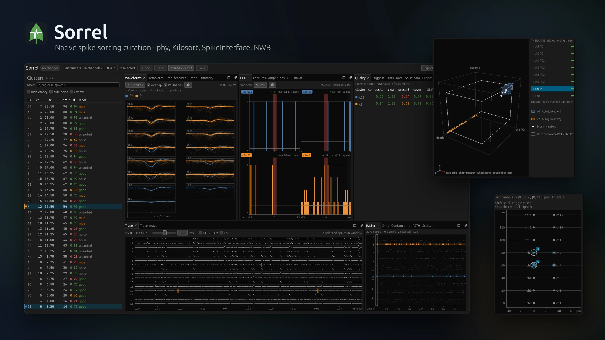

# Sorrel

<!-- simit:badges:start -->

[](.github/workflows/ci.yaml) [](flake.nix) [](docs) [](https://crates.io/crates/sorrel) [](.github/workflows/release.yml) [](https://community.chocolatey.org/) [](https://github.com/microsoft/winget-pkgs/tree/master/manifests/c/Caniko/Sorrel)

<!-- simit:badges:end -->

<p align="center"></p>

Native, high-performance GUI for manual curation of spike-sorted electrophysiology data. More views in the [gallery](https://sorrel.tartanoglu.com/#gallery).

Prebuilt releases cover Linux (x86_64 and aarch64), macOS (Apple silicon) and
Windows (x64 and ARM64).

Sorrel is built around **zero-cost abstractions**: the entire core is generic over a `DataProvider` trait, monomorphised at compile time, so hot paths (downsampling, vertex generation, journaling) cross no dynamic-dispatch boundary.

## Workspace

| Crate            | Role                                                                                                                                              |
| ---------------- | ------------------------------------------------------------------------------------------------------------------------------------------------- |
| `sorrel-io`      | Concrete data backends; `DataProvider` trait bound.                                                                                               |
| `sorrel-compute` | Generic kernels (LTTB, histograms).                                                                                                               |
| `sorrel-data`    | Generic `Session<P>`, `CurationCommand`, append-only journal, QC export, SI `curation.json`, rules, report, JSON-RPC server.                      |
| `sorrel-cache`   | Rebuildable derived-data cache (rkyv, GC).                                                                                                        |
| `sorrel-gpu`     | wgpu kernels for CMR, high-pass and mean snippets.                                                                                                |
| `sorrel-render`  | Concrete vertex types + monomorphised buffer builders.                                                                                            |
| `sorrel-ui`      | egui widgets, generic over `P: DataProvider`.                                                                                                     |
| `sorrel`         | Binary; `sorrel open <DIR>` opens the GUI, subcommands (`qc`, `suggest`, `apply`, `report`, `mcp`, `diff`, `journal`, `export-phy`) run headless. |
| `sorrel-py`      | PyO3 bindings: in-process `Session` plus the GUI launcher (outside the workspace; `maturin develop`).                                             |

## V1 (Kilosort / phy2)

```
sorrel open <KILOSORT_DIR> --dat recording.dat --sample-rate 30000 --channels 32
```

- Memory-maps `spike_times.npy`, `spike_clusters.npy`, and the raw `.dat`.
- Loads `cluster_group.tsv` into a `Vec<PhyLabel>` (1 byte per cluster).
- Curation operations are journaled synchronously to the journal **before** the in-memory state changes.

### Keyboard

Defaults; `Ctrl` is `Cmd` on macOS. Rebind in **Settings → Keyboard shortcuts**.

| Key                                   | Action                                                                                                  |
| ------------------------------------- | ------------------------------------------------------------------------------------------------------- |
| `G`                                   | Merge the selection into the first-selected cluster                                                     |
| `K`                                   | Split off the spikes inside the Features lasso                                                          |
| `Alt+G` / `Alt+M` / `Alt+N` / `Alt+U` | Label the **best** clusters Good / MUA / Noise / Unsorted (`Ctrl+…` similar, `Ctrl+Alt+…` all selected) |
| `↓` / `↑` / `Space` / `Shift+Space`   | Next / previous best cluster in table order; next / previous similar cluster                            |
| `Alt+←` / `Alt+→`                     | Pan trace window (drag / wheel in the trace also pans; Ctrl-wheel zooms)                                |
| `Ctrl+Z` / `Ctrl+Shift+Z`             | Undo / redo (`Ctrl+Y` also redoes)                                                                      |
| `Ctrl+S`                              | Save `spike_clusters.npy` + `cluster_group.tsv`                                                         |
| `H` / `?` / `F1`                      | Keyboard & mouse help overlay                                                                           |

Views are dockable tiles: drag tabs to rearrange, `×` to close, the
**View** menu to reopen. The complete keymap, snippets and mouse gestures are in
[`docs/src/usage/keyboard-controls.md`](docs/src/usage/keyboard-controls.md);
[`docs/src/usage/views.md`](docs/src/usage/views.md) covers the panes.

## Build

```
cargo build --release -p sorrel
```

## Citing

See [Citing Sorrel](docs/src/project/citing.md) for BibTeX, authorship and
acknowledgments. The metadata lives in [`CITATION.cff`](CITATION.cff).
